# Design Diagrams: EPES

All diagrams are written in Mermaid, so GitHub draws them directly in the browser. No image files are needed.

Contents: 1. Use case, 2. Architecture, 3. ER diagram, 4. Class diagram (domain), 5. Class diagram (layers), 6. Sequence diagrams, 7. Goal status state diagram, 8. Evaluation flow.

---

## 1. Use case diagram

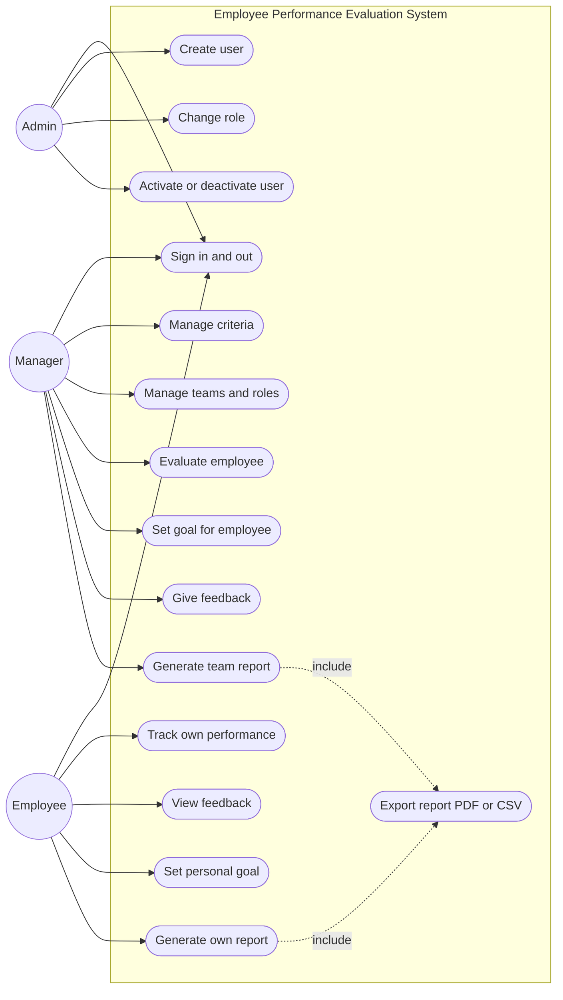

---

## 2. Architecture (layers)

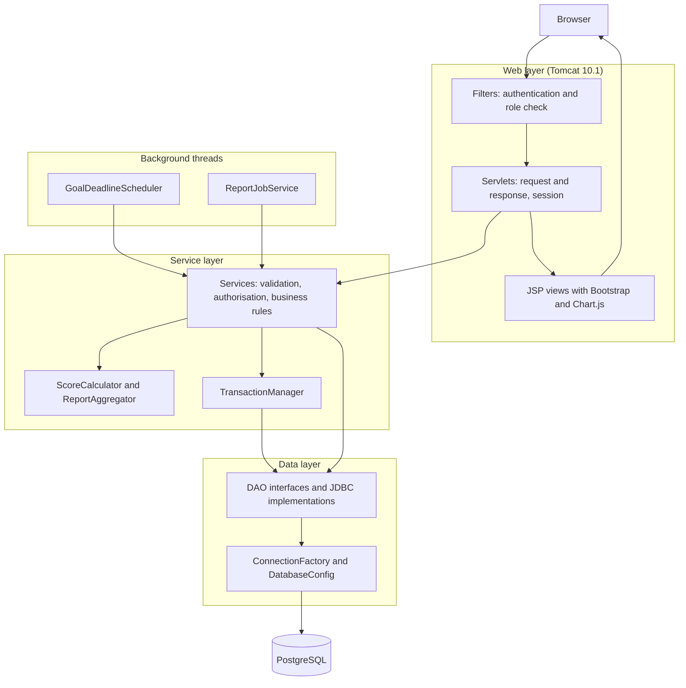

---

## 3. ER diagram

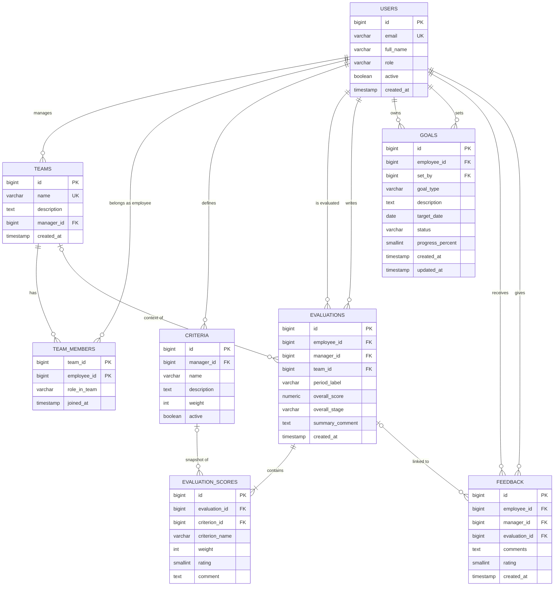

The full data dictionary with every constraint is in [../db/README.md](../db/README.md).

---

## 4. Class diagram: domain model

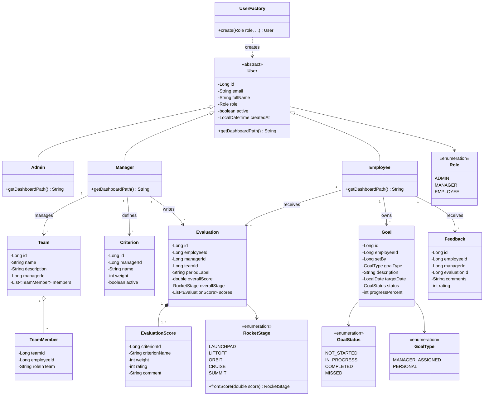

---

## 5. Class diagram: layers and DAO pattern

Shown for evaluations. The other entities follow the same pattern.

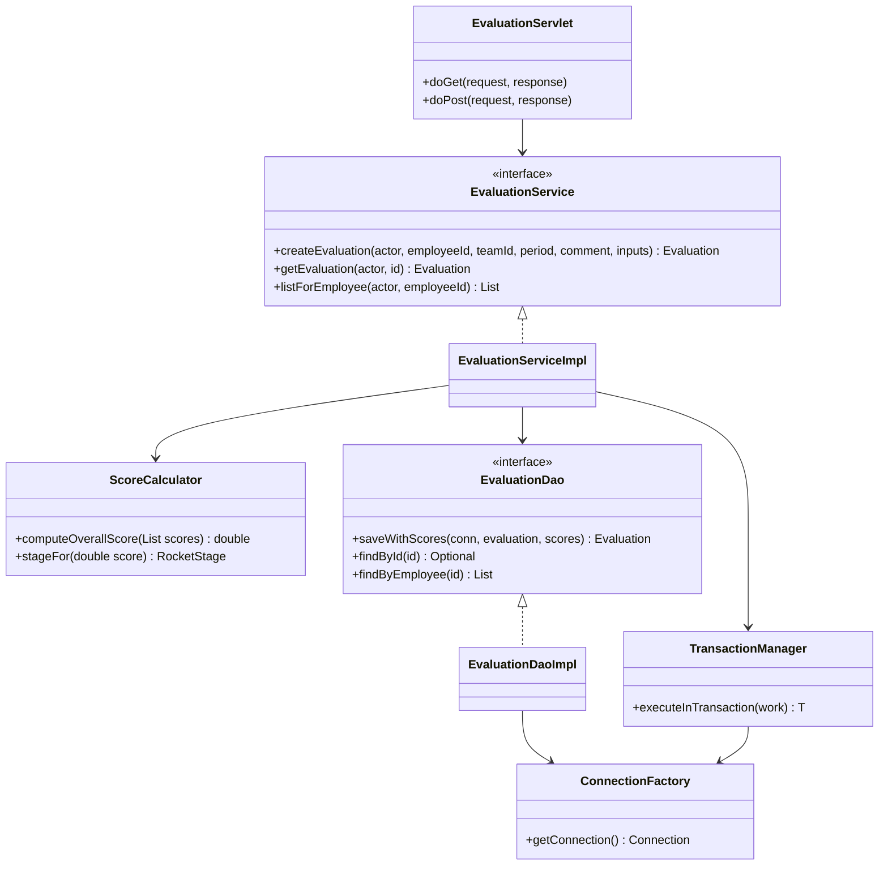

Exception hierarchy:

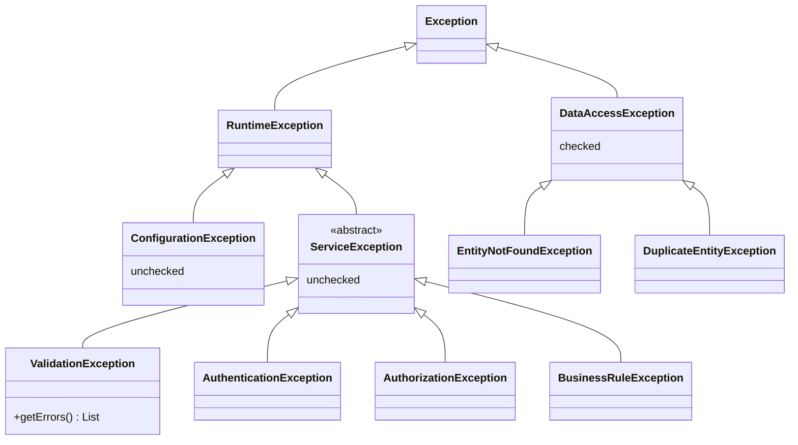

---

## 6. Sequence diagrams

### 6.1 Sign in (temporary email login)

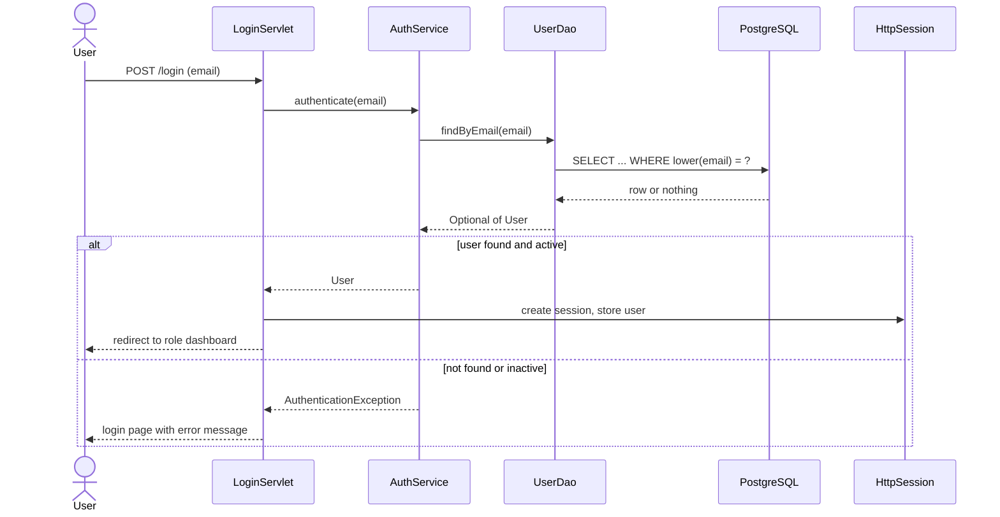

### 6.2 Manager evaluates an employee (transaction)

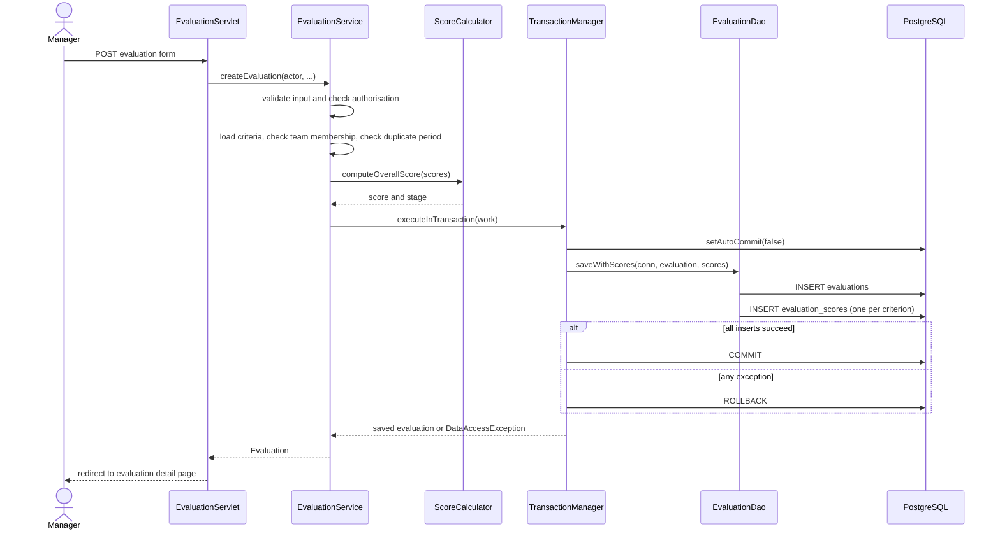

### 6.3 Overdue goal check (background thread)

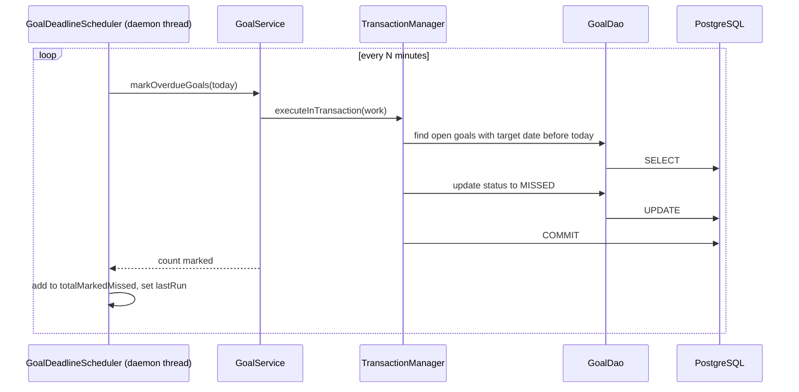

### 6.4 Report export (worker thread)

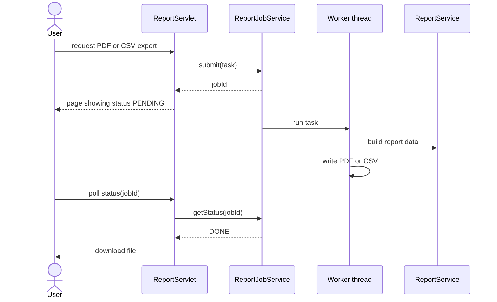

---

## 7. Goal status state diagram

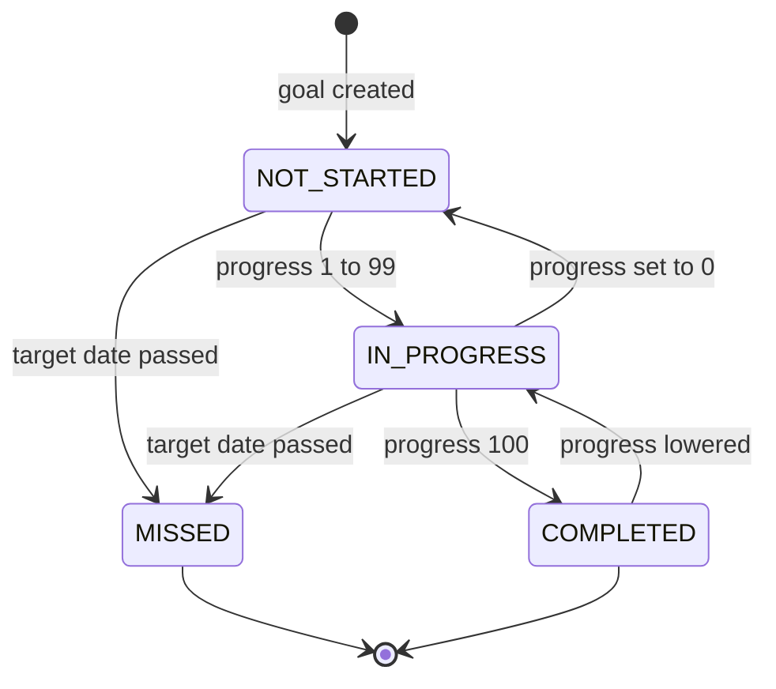

---

## 8. Evaluation flow (activity)

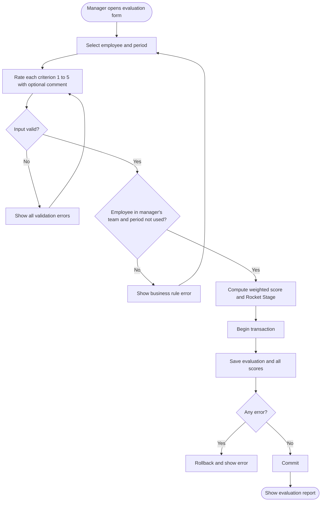
